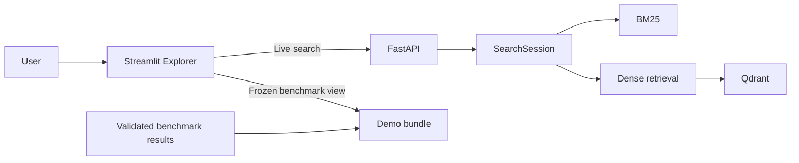

# Retrieval Under Stress

**Retrieval Under Stress** measures how controlled changes to a search query affect document rankings. It compares lexical, dense, and hybrid retrieval on the SciFact corpus, then provides a small explorer for inspecting both benchmark results and live searches.

The project has two distinct parts:

- **The benchmark** runs retrieval against frozen query variants and relevance judgments, then evaluates the saved rankings.
- **The explorer** displays those frozen results and sends new, arbitrary searches to a live API.

The explorer is a presentation layer. It does not rerun or change the benchmark.

## What the project does

The benchmark compares three retrieval methods:

| Method | Description |
|---|---|
| BM25 | Lexical retrieval based on term matching |
| Dense | Semantic retrieval using `all-MiniLM-L6-v2` embeddings and Qdrant |
| Hybrid | Reciprocal Rank Fusion (RRF) over the BM25 and dense rankings |

The hybrid method uses RRF with `k = 60`. The retrieval pipeline considers up to 100 candidates; evaluation metrics are reported at rank 10.

The frozen benchmark compares clean queries with the available perturbed versions, including light typos, heavy typos, and paraphrases. It records per-query metrics and ranked results so the effects of perturbations can be examined directly.

## Architecture



The two explorer tabs use different data paths:

- **Live Search** sends a new query to FastAPI, which runs the selected retrieval method.
- **Robustness Explorer** reads saved benchmark results from a compact demo bundle. It does not rerun retrieval.

## Evaluation

The benchmark reports:

- **nDCG@10** — ranking quality with graded relevance, giving more weight to relevant documents near the top.
- **Recall@10** — the fraction of judged-relevant documents retrieved in the top 10.
- **MRR@10** — the reciprocal rank of the first relevant document, averaged across queries.

BM25, dense, and RRF score magnitudes are not directly comparable. Compare their rankings and evaluation metrics instead.

## Repository layout

The repository includes the retrieval package, benchmark scripts, tests, API, and demo application. The main files and directories include:

```text
configs/                 Benchmark and latency configuration
data/                    Dataset and processed benchmark inputs
demo/                    Streamlit app and frozen demo bundle
docs/                    Design decisions and project documentation
reproductions/           Local reproduction outputs
results/                 Benchmark results and analysis outputs
scripts/                 Reproduction, analysis, and utility scripts
tests/                   Unit and integration tests
Dockerfile.api           FastAPI container
Dockerfile.frontend      Streamlit container
compose.yaml              Local multi-service stack
```

Generated results under `reproductions/` are local outputs. They do not need to be added to Git.

## Requirements

For local development:

- Python 3.11
- [uv](https://docs.astral.sh/uv/)
- Git

For the complete containerized application:

- Docker
- Docker Compose

The first run may need to download the dataset and embedding model, and may take longer than subsequent runs.

## Reproduce the benchmark

### 1. Get the source and install dependencies

```bash
git clone <repository-url>
cd retrieval-under-stress

uv sync --locked
```

### 2. Check the environment

Run the non-integration test suite:

```bash
uv run --locked pytest -m "not integration"
```

If the project uses Ruff for linting and formatting, check those too:

```bash
uv run --locked ruff check .
uv run --locked ruff format --check .
```

### 3. Configure latency measurement

The reproduction workflow includes latency measurement. Before running it, complete `configs/latency-environment.json` with the machine and environment details requested by that file.

The latency script checks that the timing implementation and environment have been committed. Commit those source and configuration changes before running the full reproduction. Do not add the generated `reproductions/` output directory to Git.

Latency depends on the machine and software environment. Record those details alongside the timing results; do not interpret latency as a hardware-independent benchmark result.

### 4. Run the reproduction

Choose a new output directory for the run:

```bash
uv run --locked python scripts/reproduce.py reproductions/repro-v1
```

The reproduction writes its generated artifacts to the directory you provide. Use another directory name, such as `reproductions/repro-v2`, for a later run so you can keep the outputs separate.

### 5. Review the outputs

After the run completes, inspect the output directory and its manifests. Check that:

- all expected query conditions and retrieval methods have results;
- the analysis completed for the same frozen dataset and run;
- recorded checksums and manifests are present and consistent;
- metric tables and figures were generated;
- latency output includes the environment details used for that measurement.

Keep the generated outputs available when comparing runs. Do not edit frozen input data or result files in place; create a new reproduction output directory for a new run.

## Run the interactive explorer

### Option A: Docker Compose

Build and start Qdrant, the API, and the frontend:

```bash
docker compose up --build --wait --wait-timeout 600
```

Open the explorer at:

```text
http://127.0.0.1:8501
```

The API is available to the frontend inside the Compose network. The browser connects to Streamlit; it does not call the API directly.

To stop the services:

```bash
docker compose down
```

### Option B: Run the API and frontend separately

Start Qdrant using the project’s Compose configuration, then start the API:

```bash
docker compose up -d qdrant
uv run uvicorn retrieval_lab.api.app:app --host 127.0.0.1 --port 8000
```

In another terminal, start Streamlit:

```bash
uv run --project demo --locked streamlit run demo/app.py \
  --server.address 127.0.0.1 \
  --server.port 8501
```

Open `http://127.0.0.1:8501`. In this setup, the frontend should use `http://127.0.0.1:8000` for its API URL.

## Use the explorer

### Live Search

1. Enter an arbitrary query.
2. Choose BM25, Dense, or Hybrid retrieval.
3. Set the displayed result depth.
4. Optionally compare all three methods.
5. Review the rankings and document overlap.

Live Search has no relevance judgments for arbitrary queries, so it displays retrieval results rather than benchmark quality metrics.

### Robustness Explorer

1. Choose a perturbation condition.
2. Select a query from the frozen benchmark.
3. Compare its clean and perturbed wording.
4. Review the saved nDCG@10, Recall@10, and MRR@10 values.
5. Compare the clean and perturbed rankings, including documents marked relevant by the benchmark’s judgments.

Only documents marked relevant in the judgments are highlighted. A document without a relevance label should be treated as unjudged, not necessarily irrelevant.

## Frozen demo bundle

The Robustness Explorer uses a compact bundle generated from validated benchmark outputs. The bundle contains the query variants, judgments, saved metrics, top-ranked documents, and document text needed by the interface.

The bundle has a SHA-256 checksum so accidental changes can be detected. The explorer reads this saved evidence; it does not recompute the benchmark when someone changes a control.

If regenerating the bundle, use the project’s exporter with a completed, validated benchmark run. For example:

```bash
uv run --locked python scripts/export_demo_bundle.py \
  results/stress-test-v1 \
  demo/benchmark-v1.json
```

Regenerating the bundle changes the artifact used by the demo. Keep the benchmark source and manifests associated with it so the displayed results remain traceable.

## Reproducibility notes

- Use the locked dependency files and the documented benchmark inputs.
- Preserve the frozen query variants, relevance judgments, and manifests.
- Store each reproduction in a separate output directory.
- Treat latency as environment-specific and report the machine and software details.
- Keep live searches separate from the judged benchmark: they answer different questions.
- The interactive explorer presents experimental results; it is not itself part of the benchmark reproduction pipeline.

## Current scope

The project focuses on query perturbation robustness for BM25, dense retrieval, and RRF-based hybrid retrieval on SciFact. It does not generate answers, use an LLM to judge relevance, or allow the explorer to modify the benchmark configuration.


## Kubernetes deployment

The application can run on Kubernetes using a Helm chart. The deployment
includes the FastAPI retrieval service, Streamlit explorer, and Qdrant.

Docker Compose remains available for local development.

### Deployment status

- Local deployment with kind and Helm is working.
- Deployment to Google Kubernetes Engine is in progress and has not yet
  completed end-to-end validation.

### Architecture

| Component | Kubernetes resource | Purpose |
|---|---|---|
| FastAPI | Deployment and Service | Serve BM25, dense, and hybrid searches |
| Streamlit | Deployment and Service | Provide Live Search and the Robustness Explorer |
| Qdrant | StatefulSet and Services | Store and search document embeddings |
| Qdrant storage | PersistentVolumeClaim | Preserve the collection across Pod replacement |
| Model cache | PersistentVolumeClaim | Reuse downloaded model files |
| Frozen corpus | Data image and init container | Populate a read-only corpus volume for the API |
| API configuration | ConfigMap | Configure data paths and service addresses |

The API runs with one replica and one Uvicorn worker. During startup,
it loads the corpus and model and initializes or reuses the fingerprinted
Qdrant collection.

The frontend accesses the API through its internal Kubernetes Service.
The Robustness Explorer continues to read the frozen benchmark bundle.

### Requirements

- Docker
- kind
- kubectl
- Helm
- The prepared corpus in `data/processed/stress-test-v1/clean`
- The pinned model configuration in `configs/dense-model.json`
- The frontend benchmark bundle and its checksum
- A pinned Qdrant image in
  `helm/retrieval-under-stress/values-kind.yaml`

The first startup requires internet access to download uncached model
files and container images.

### Run locally with kind

From the repository root, create a cluster if it does not already exist:

```bash
kind create cluster --name retrieval-stress --wait 120s
```

Build the application images:

```bash
docker build \
  --file Dockerfile.api \
  --tag retrieval-api:k8s-v1 \
  .

docker build \
  --file Dockerfile.frontend \
  --tag retrieval-frontend:k8s-v1 \
  .

docker build \
  --file deploy/Dockerfile.data \
  --tag retrieval-data:scifact-v1 \
  data/processed/stress-test-v1/clean
```

The data image uses the clean dataset directory as its build context.

Load the images into kind:

```bash
kind load docker-image \
  retrieval-api:k8s-v1 \
  retrieval-frontend:k8s-v1 \
  retrieval-data:scifact-v1 \
  --name retrieval-stress
```

The image references in the chart's values files must match these tags.

Validate and install the chart:

```bash
helm lint helm/retrieval-under-stress \
  -f helm/retrieval-under-stress/values-kind.yaml

helm upgrade --install retrieval \
  helm/retrieval-under-stress \
  --kube-context kind-retrieval-stress \
  --namespace retrieval-stress \
  --create-namespace \
  -f helm/retrieval-under-stress/values-kind.yaml \
  --wait \
  --timeout 40m
```

Inspect the deployment:

```bash
kubectl --context kind-retrieval-stress \
  get pods,services,pvc \
  -n retrieval-stress
```

Forward the frontend to your machine:

```bash
kubectl --context kind-retrieval-stress \
  port-forward \
  -n retrieval-stress \
  service/frontend \
  18501:8501
```

Open http://127.0.0.1:18501.

### Startup and health checks

The API's init containers copy the frozen corpus and wait for Qdrant.
The API then loads its resources and builds or reuses the retrieval index.

Cold initialization can take several minutes. Subsequent starts reuse
the persisted model cache and a matching, complete Qdrant collection.

| Endpoint | Purpose |
|---|---|
| `/livez` | Check whether the API process can respond |
| `/readyz` | Check resource initialization and expected collection size |
| `/health` | Report application and index metadata |

A startup probe allows time for initialization. Readiness checks exclude
an unavailable API instance from Service traffic. Liveness checks assess
the API independently of Qdrant availability.

To inspect API startup:

```bash
kubectl --context kind-retrieval-stress \
  logs deployment/api \
  -n retrieval-stress \
  -c api \
  --follow
```

### Deployment acceptance checks

After installation, verify that:

- BM25, dense, and hybrid searches return results.
- The Streamlit explorer displays live and frozen benchmark results.
- Replacing the Qdrant Pod preserves the collection.
- Restarting the API reuses the existing collection.
- A Qdrant outage makes the API unready without causing an API restart loop.
- Readiness recovers when Qdrant becomes available again.

### Scope and limitations

This configuration is a single-instance learning deployment. It does not
provide application-level high availability, automatic horizontal scaling,
or multi-region failover.

The API uses the `Recreate` update strategy, so API updates introduce
temporary downtime. Scaling the API requires revisiting index
initialization and model-cache access.

Kubernetes deploys the serving application. It does not modify the frozen
benchmark, recompute reported metrics, or replace the reproduction workflow.

### Cleanup

Remove the Helm release:

```bash
helm uninstall retrieval \
  --kube-context kind-retrieval-stress \
  --namespace retrieval-stress
```

The model-cache PVC and StatefulSet-created Qdrant PVC are retained.

To remove the deployment's remaining resources, including those PVCs:

```bash
kubectl --context kind-retrieval-stress \
  delete namespace retrieval-stress
```

To remove the entire local cluster:

```bash
kind delete cluster --name retrieval-stress
```

Deleting the namespace or cluster removes the corresponding persisted
deployment data.